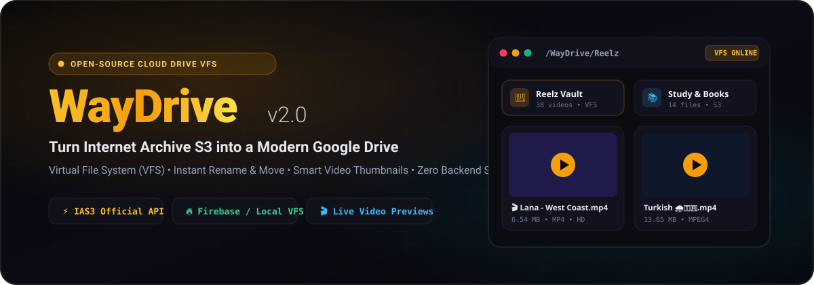
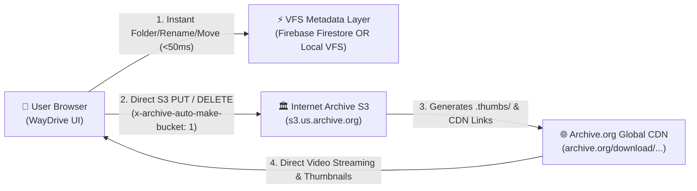

<div align="center">



<br/>

# ⚡ WayDrive

**Turn Internet Archive's Unlimited Free S3 Storage (`IAS3`) into a Modern, Lightning-Fast Cloud Drive.**  
*Powered by a Hybrid Virtual File System (Firebase Firestore / Local VFS) + Official Internet Archive S3 API.*

[](https://ayoubvvch.github.io/WayDrive/)
[](docs/ARCHIVE_S3_GUIDE.md)
[](LICENSE)
[](#architecture)

[**🇬🇧 English Overview**](#-why-waydrive) • [**🇸🇦 الشرح بالعربية**](#-شرح-المشروع-بالعربية) • [**📊 Archive.org S3 Limits & API Guide**](#-internet-archive-s3-ias3-limits--engineering-cheat-sheet) • [**⚡ 60-Second Quick Start**](#-60-second-quick-start)

</div>

---

## 💡 Why WayDrive?

The **Internet Archive (`archive.org`)** provides an official S3-compatible API (`https://s3.us.archive.org`) with **unlimited free storage** for archival, educational, and creative media. However, using Archive.org directly as a personal cloud drive is painful:

| Raw Internet Archive (`archive.org`) | ⚡ **WayDrive (Virtual File System)** |
| :--- | :--- |
| ❌ Every upload creates a separate, messy bucket in root | ✅ **True Nested Folders** (`/WayDrive/Reelz`, `/WayDrive/Books`) |
| ❌ Renaming takes 10+ minutes via catalog tasks (or fails on emojis/Arabic) | ✅ **Instant `< 50ms` Rename & Move** (Full Arabic, Emoji & UTF-8 support) |
| ❌ Cluttered with `_meta.xml`, `_files.xml`, `.sqlite`, `.torrent`, `.ia.mp4` | ✅ **100% Clean Drive View** (System derivatives hidden automatically) |
| ❌ Moving files between buckets requires re-uploading | ✅ **Drag-and-Drop & Batch Move Modal** across any folder |
| ❌ Missing or slow `__ia_thumb.jpg` shows ugly placeholder icons | ✅ **Smart Video Thumbnails** (`.thumbs/` auto-upgrade + live `<video>` frame fallback) |
| ❌ Requires complex CLI tools (`ia` CLI / Python) | ✅ **Zero-Backend Web App** (Runs on GitHub Pages, local file, or any static host) |

---

## ✨ Key Features

- 🗂️ **True Virtual File System (Dual VFS Engine):**
  - **⚡ Local Browser VFS Mode (Zero-Setup):** Start in **10 seconds** using *only* your Archive.org S3 keys—no database setup required!
  - **☁️ Firebase Firestore VFS Mode:** Connect a free Firebase project for **real-time multi-device cloud synchronization** while keeping Firestore usage under **500 bytes per file** ( easily storing 2,000+ files inside Firebase's free 1 MB / 1 GiB tier!).
- 🎬 **Smart Video Grid & Built-in Plyr Media Center:**
  - Single-click to play videos and audio in a floating, minimizable **Plyr.io** theater player with playback speed controls, loop mode, and keyboard shortcuts.
  - **Zero-Placeholder Thumbnail Engine:** Automatically upgrades video thumbnails to Archive.org's generated `.thumbs/` frames and falls back to live `<video preload="metadata">` frame extraction if Archive.org is still processing a new upload.
- 🧭 **OS-Style Path Bar & File Inspector Drawer:**
  - Toggle between clickable Breadcrumbs (`My Drive > Reelz`) and raw OS/Phone paths (`/WayDrive/Reelz/video.mp4`) with one-click path copying.
  - Slide-over **File Details Inspector** showing Virtual Path, Direct CDN Download Link, S3 Bucket Identifier, S3 Object Key, File Size, and Timestamps.
- 🔄 **Non-Destructive Smart Sync:**
  - Syncs missing thumbnails and new uploads from your Archive.org account **without** recreating deleted wrapper folders, duplicating moved files, or importing system junk files.
- 📦 **Batch Operations & Drag-and-Drop:**
  - Rubber-band marquee selection, drag-and-drop file/folder uploads with real-time progress widget, and one-click client-side **ZIP bundling** (`JSZip`).

---

## 🏗️ Architecture



> **How WayDrive keeps Firebase 100% within the Free Tier:**  
> WayDrive **never** stores binary files or Base64 images in Firebase. Binary files live on Internet Archive S3, while Firebase only stores lightweight JSON pointers (`name`, `parentId`, `downloadUrl`, `thumbnailUrl`, `mtime` — ~350 bytes per document).

---

## 📊 Internet Archive S3 (`IAS3`) Limits & Engineering Cheat-Sheet

Want to build on Archive.org S3 or understand its limits? Here is what every developer needs to know (see full guide in [**`docs/ARCHIVE_S3_GUIDE.md`**](docs/ARCHIVE_S3_GUIDE.md)):

| Parameter | Limit / Behavior | Best Practice in WayDrive |
| :--- | :--- | :--- |
| **Total Storage** | **Unlimited** *(Free)* | Use for legal media, educational archives, open-source backups, and creative content. |
| **Max Bucket (Item) Size** | **1 TB** Hard / **500 GB** Recommended | Keep individual buckets under **500 GB** and **< 1,000 files** to prevent catalog derive timeouts. |
| **Large Files (`> 10 GB`)** | Requires size hint header | WayDrive automatically sends `x-archive-size-hint: <bytes>` on every upload. |
| **Rate Limit / Throttling** | Task-queue based (`HTTP 503 SlowDown`) | Query `https://s3.us.archive.org/?check_limit=1&accesskey=KEY` (`over_limit: 0`). Use 1–3 concurrent uploads. |
| **Clean Deletion** | Derivatives remain unless cascaded | WayDrive sends `x-archive-cascade-delete: 1` on `DELETE` to remove generated derivatives cleanly. |

---

## ⚡ 60-Second Quick Start

### Option 1: Instant Use via Live Web App (Zero Installation)
1. Open [**https://ayoubvvch.github.io/WayDrive/**](https://ayoubvvch.github.io/WayDrive/)
2. Get your free official Internet Archive S3 keys at **[archive.org/account/s3.php](https://archive.org/account/s3.php)**
3. Paste your **S3 Access Key** & **Secret Key** into the **WayDrive Cloud & VFS Setup** modal:
   - Choose **⚡ Local Browser VFS** for instant zero-setup usage, **OR**
   - Choose **☁️ Firebase Firestore VFS** and paste your `firebaseConfig` for multi-device sync!
4. Click **Test S3 & Queue Limit** → **Save & Connect**. Done!

### Option 2: Self-Host / Clone Locally
```bash
git clone https://github.com/Ayoubvvch/WayDrive.git
cd WayDrive
# Open index.html directly in your browser or serve with any static server:
npx serve .
```

---

<div dir="rtl">

## 🇸🇦 شرح المشروع بالعربية

**WayDrive** هو مشروع مفتوح المصدر يحوّل مساحة التخزين المجانية وغير المحدودة في **أرشيف الإنترنت (`Archive.org`)** إلى تجربة **Google Drive** حديثة وسريعة للغاية، بالاعتماد على واجهة **S3 الرسمية (`IAS3`)** ونظام ملفات افتراضي ذكي (**Virtual File System**).

### 🔥 ماذا يقدّم WayDrive؟
1. **وداعاً لفوضى Archive.org:** في الأرشيف العادي، كل ملف ترفعه ينشئ مجلداً (Bucket) منفصلاً مليئاً بملفات النظام المزعجة (`_meta.xml`, `.sqlite`, `.torrent`, `.ia.mp4`). في **WayDrive**، يمكنك إنشاء مجلدات حقيقية (مثل `Reelz` أو `Books`)، ونقل الملفات بينها بالسحب والإفلات، وإعادة تسميتها بالعربية والإيموجي في **أجزاء من الثانية** دون انتظار خوادم الأرشيف!
2. **يعمل بطريقتين (Dual VFS Engine):**
   - **الوضع الفوري (Local Browser VFS):** فقط ضع مفاتيح S3 الخاصة بك من [archive.org/account/s3.php](https://archive.org/account/s3.php) وسيعمل معك الموقع فوراً بدون الحاجة لإنشاء قاعدة بيانات!
   - **وضع المزامنة السحابية (Firebase Firestore VFS):** اربط مشروع Firebase مجاني لتتزامن مجلداتك وترتيبك وأسماء ملفاتك بين هاتفك وحاسوبك لحظياً (كل ملف يستهلك أقل من `0.4 KB` فقط كروابط نصية!).
3. **معاينة ذكية للفيديوهات والريلز:** يلتقط الصور المصغرة تلقائياً من مجلد `.thumbs/`، وإذا كان الفيديو مرفوعاً للتو ولم يجهز الأرشيف صورته بعد، يعرض لقطة حية مباشرة من الفيديو بدلاً من شعار الأرشيف الأسود!
4. **قانوني وآمن 100%:** يستخدم الـ API الرسمي لـ Archive.org (`https://s3.us.archive.org`)، وتُحفظ مفاتيحك محلياً في متصفحك فقط (`localStorage`) ولا تُرسل لأي طرف ثالث.

</div>

---

## ⚖️ Legal & Acceptable Use Disclaimer

WayDrive is an independent open-source client interface powered by the official [Internet Archive S3 (`IAS3`) API](https://archive.org/ developers/ias3.html).
- All files uploaded through WayDrive are hosted on the [Internet Archive](https://archive.org) and are subject to the [Internet Archive Terms of Use](https://archive.org/about/terms.php).
- Users are solely responsible for ensuring that their uploaded content is legal and non-infringing. Do not upload sensitive unencrypted private data or unauthorized copyrighted material.

---

<div align="center">

**Built with ❤️ by [Ayoubvvch](https://github.com/Ayoubvvch)**  
*If you find WayDrive useful, please give the repository a ⭐ **Star** on GitHub to help others discover it!*

</div>
